

  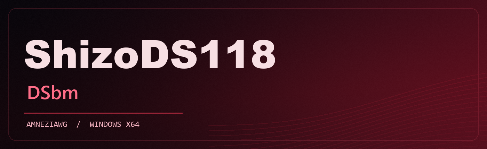

## Маршрутизация точечно

**Можно пустить Chrome напрямую, а остальные программы оставить на обычном маршруте VPN.** Выбранные приложения и их режимы сохраняются после выключения ПК.

1. Запусти Chrome. Если VPN уже подключён, отключи его на время настройки.
2. Открой **Маршрутизация точечно → Выбрать запущенные приложения…**. Найди **Chrome** по значку или введи в поиск **chrome.exe**.
3. Нажми **Добавить выбранные** и поставь нужный режим в строке Chrome.
4. Подключи VPN и открой **Active Connections**, чтобы посмотреть адреса и маршрут, который сообщает движок.

| Режим | Как работает |
|:--|:--|
| **AMG** | Обычный маршрут через AmneziaWG. |
| **DIRECT** | Обход туннеля по IP назначения. Если другой процесс обращается к тому же IP, правило действует и на него. |

  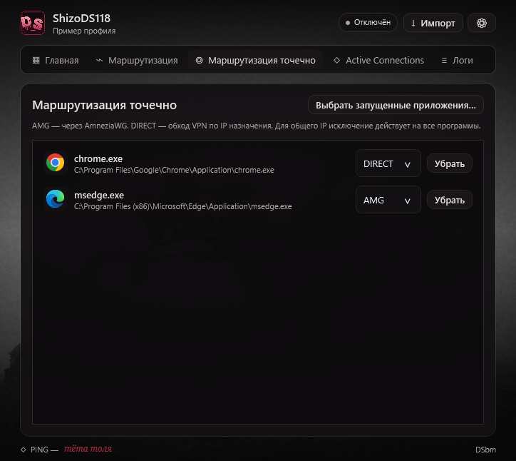

## Скачать

**[ShizoDS118 4.4 Preview · офлайн-установщик для Windows x64](https://github.com/cheatty/ShizoDS118/releases/download/v4.4.0-preview/ShizoDS118-4.4-Preview-Setup-Offline.exe)**

[Что добавлено в версии 4.4](https://github.com/cheatty/ShizoDS118/releases/tag/v4.4.0-preview)

Перед обновлением выйди из старой версии через трей. После установки открой **Импорт**, выбери свой файл AmneziaWG **.conf** или вставь его текст. В том же окне есть **КФГ от Чипика · @chipikVPNbot**. Для запуска VPN нужен действующий профиль. [Открыть бота в Telegram](https://t.me/chipikVPNbot)

## DSbm

Чёрно-красная тема с лесным фоном, медленным переливом вокруг кнопки и брызгами, которые стекают по экрану и затухают. Эффект включается при подключении VPN. Фотографии внутри темы меняются каждые пять минут, если включена автосмена. DSbm выбирается при первом запуске.

  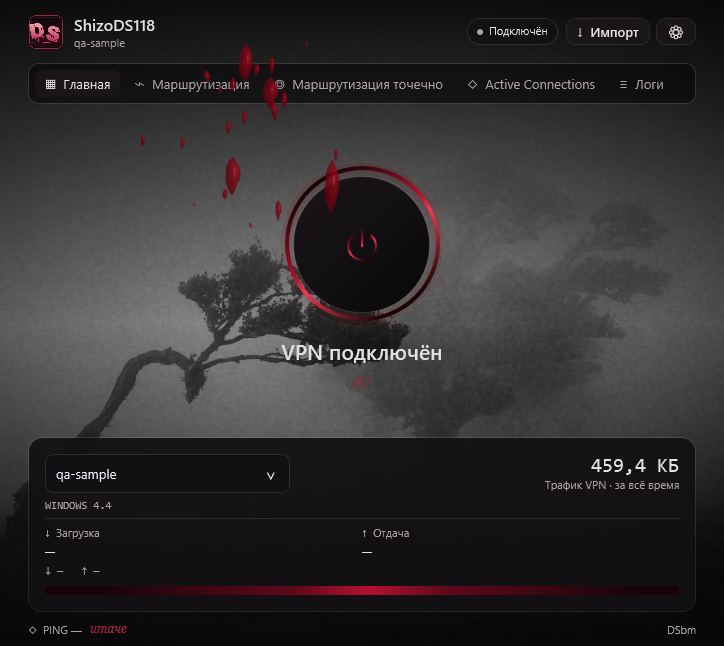

## Что есть в приложении

- **VPN.** Импорт AmneziaWG из файла или текста, Full Tunnel, DIRECT по IP/CIDR и доменам в пределах возможностей AmneziaGeo.
- **Трафик.** Загрузка и отдача за текущую сессию, текущая скорость и накопительный счётчик VPN. Общий объём хранится локально и начинает считаться с версии 4.4.
- **Active Connections.** Процессы, IP, порты и найденные домены. Метка **≈** означает возможное имя по DNS-кэшу. Доступен фильтр по добавленным приложениям.
- **Логи.** Журналы AmneziaGeo, DNS и маршрутов с поиском.
- **Трей и автозапуск.** Статус VPN и пинг в трее. В настройках можно включить запуск клиента и подключение выбранного профиля при входе в Windows.
- **Темы.** DSbm, AURORA, OCEAN, EMERALD, SAKURA, SUNSET и редактор своей палитры.

| Active Connections | Логи |
|:--:|:--:|
| 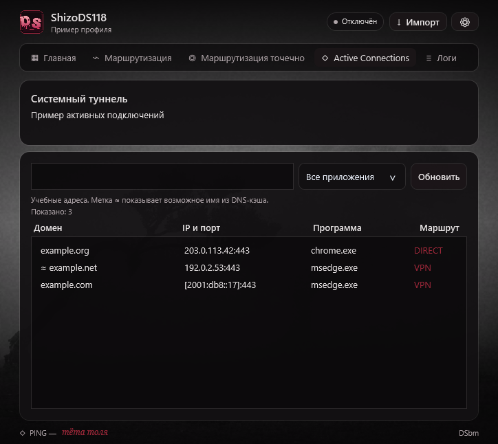 | 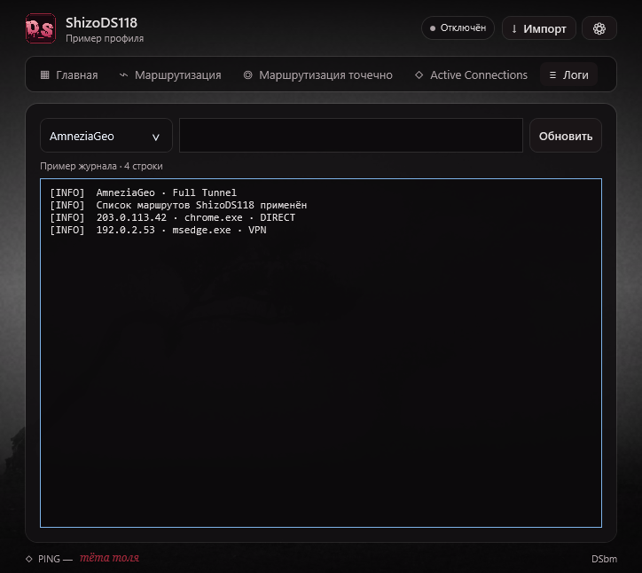 |

Адреса и записи в примерах выше учебные.

## Темы

| AURORA | OCEAN | EMERALD |
|:--:|:--:|:--:|
| 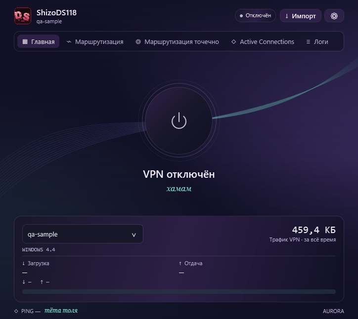 | 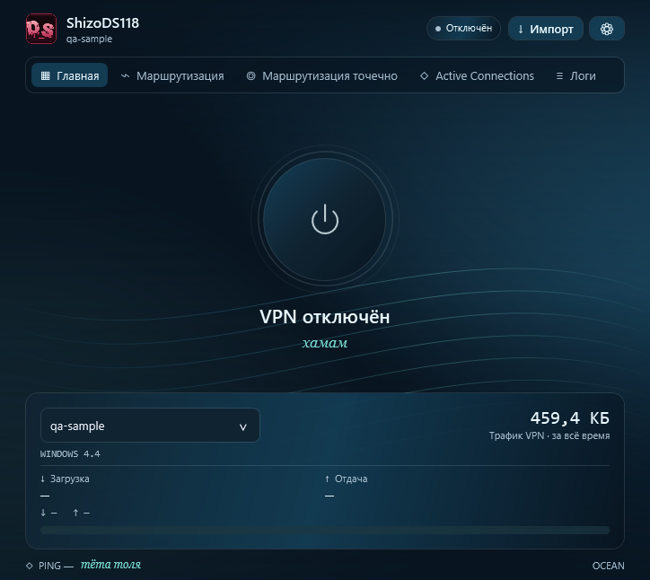 | 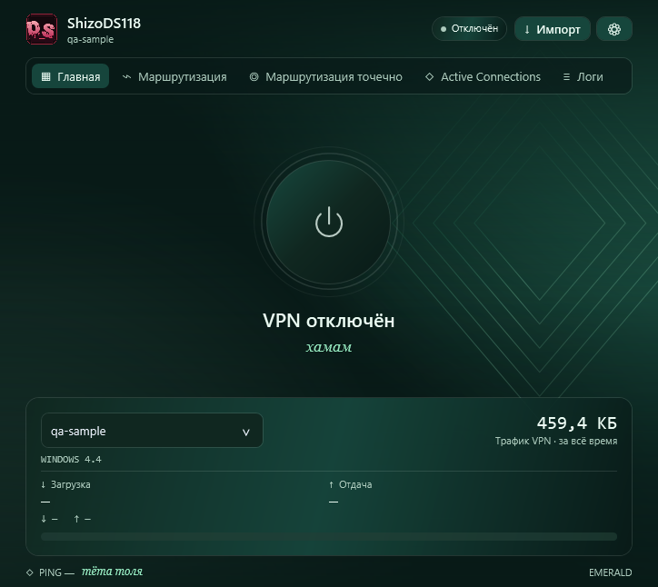 |

| SAKURA | SUNSET | Своя тема |
|:--:|:--:|:--:|
| 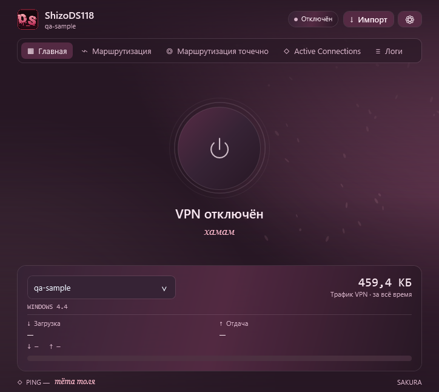 | 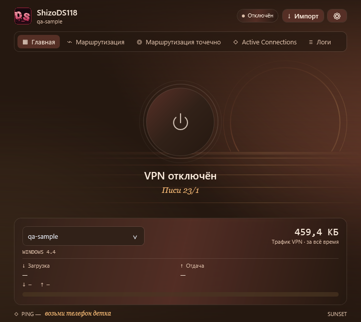 | 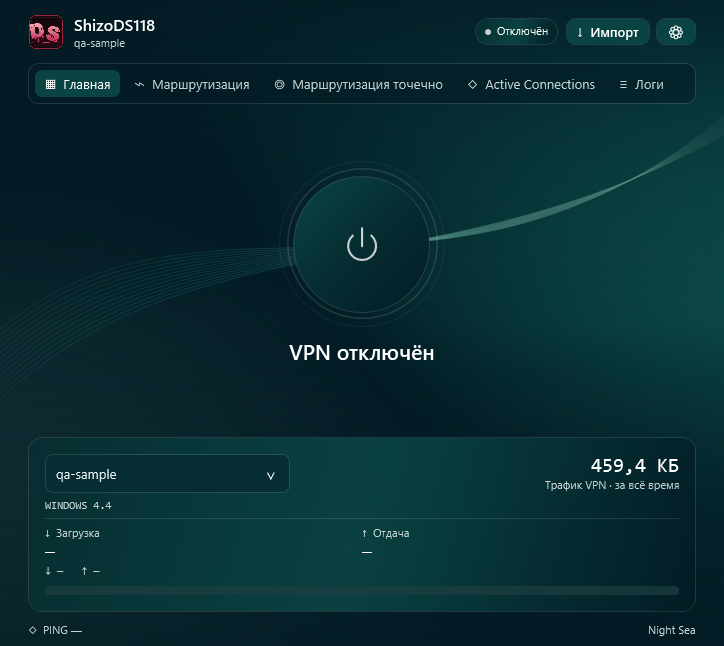 |

Настройки оформления и фон DSbm

  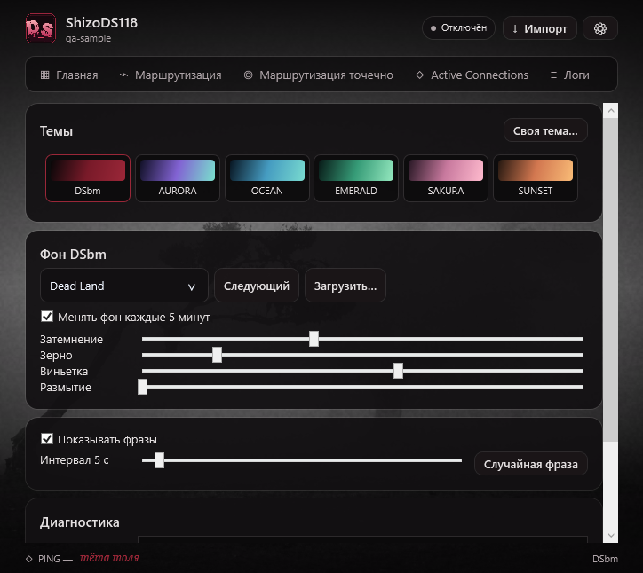

## Движок и режим Preview

ShizoDS118 использует AmneziaGeo 1.11.3.0. Сборка Preview прошла проверку установки, сохранения правил и счётчика и чтения локальных соединений. Сквозная проверка внешнего трафика VPN и DIRECT остаётся отдельной задачей. [Движок AmneziaGeo и его лицензия](https://github.com/bor-project/amneziageo)
